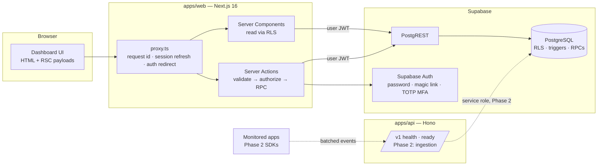
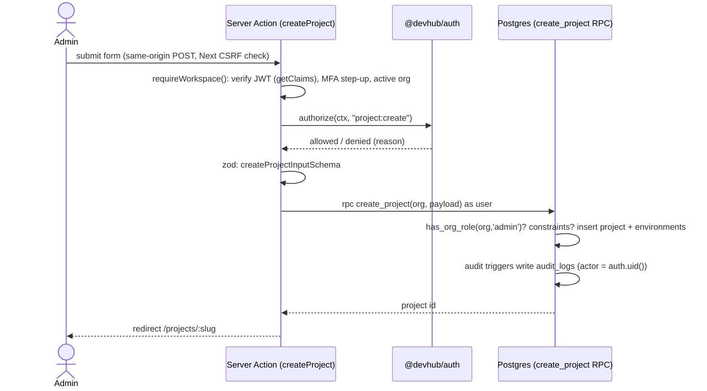

# Architecture

DevHub HQ is a **modular monolith** on a **Supabase-first** backend: one
PostgreSQL database (Supabase) is the source of truth, with separately
runnable processes that share typed contracts.

## Components

The browser talks **only to the DevHub origin**. Supabase is reached from the
server with the signed-in user's JWT, so every dashboard read and write is
subject to Row Level Security. The service-role key is never loaded by the
dashboard; from Phase 2 it is used only by `apps/api` (and a worker, if one
becomes necessary) after server-side authentication of SDK credentials.

## Request flow: registering a project

Authorization is enforced **twice, independently**: in TypeScript before the
call (clear error messages, no wasted round trips) and in the database (RLS,
column grants and `SECURITY DEFINER` RPCs that re-check roles). A bug in one
layer does not open the data.

## Repository layout

| Path                    | Responsibility                                                                                    |
| ----------------------- | ------------------------------------------------------------------------------------------------- |
| `apps/web`              | Dashboard: pages, server actions, proxy. No service-role access.                                  |
| `apps/api`              | Versioned HTTP API. Phase 1: health/readiness and shared conventions. Phase 2: ingestion gateway. |
| `packages/contracts`    | Zod schemas and closed vocabularies shared by every process; health derivation.                   |
| `packages/auth`         | Roles, permissions, `authorize()`. Pure and unit-tested.                                          |
| `packages/database`     | Typed schema for supabase-js, DB error mapping, PGlite test harness, migration checker.           |
| `packages/ui`           | Accessible, token-driven React components.                                                        |
| `supabase/migrations`   | Versioned SQL — the schema, RLS, grants, RPCs, retention.                                         |
| `infrastructure/docker` | Dockerfiles and compose.                                                                          |
| `tests/e2e`             | Playwright tests against the production build.                                                    |

Dependency direction is one-way: `apps/* → packages/*`, and
`database → auth, contracts`. No package imports an app; there are no cycles.

Planned packages (`sdk-core`, `sdk-browser`, `sdk-node`, `sdk-nextjs`,
`integrations`, `telemetry`, `testing`) are created in the phase that first
needs them rather than as empty shells.

## Key decisions

| Decision                                                     | Why                                                                                                                                                                                               |
| ------------------------------------------------------------ | ------------------------------------------------------------------------------------------------------------------------------------------------------------------------------------------------- |
| Supabase Postgres as the only datastore in Phase 1           | Requirements favour starting with Postgres-based event storage. Redis/BullMQ, a separate worker and specialized telemetry storage are added only when load tests justify them (see `roadmap.md`). |
| Dashboard reads through RLS with the user's JWT              | Tenant isolation does not depend on every query remembering a `where organization_id = …`.                                                                                                        |
| Writes through RPCs / column grants, never table-wide INSERT | Clients cannot set server-managed fields (`connection_status`, ownership, timestamps). Enforced by `pnpm db:check`.                                                                               |
| Audit by database triggers                                   | Every write path — dashboard, SQL console, future workers — is recorded; the log is append-only even for the service role.                                                                        |
| Runtime (not build-time) Supabase config                     | One image for every environment; Supabase URL/key never appear in the JS bundle (e2e-tested).                                                                                                     |
| PGlite (PostgreSQL 18 in WASM) for DB tests                  | Real Postgres semantics (RLS, grants, triggers) with no Docker requirement. CI additionally applies migrations to real Supabase Postgres.                                                         |
| Hono for `apps/api`                                          | Small, fast, standards-based (`Request`/`Response`), trivially testable with `app.request()`.                                                                                                     |
